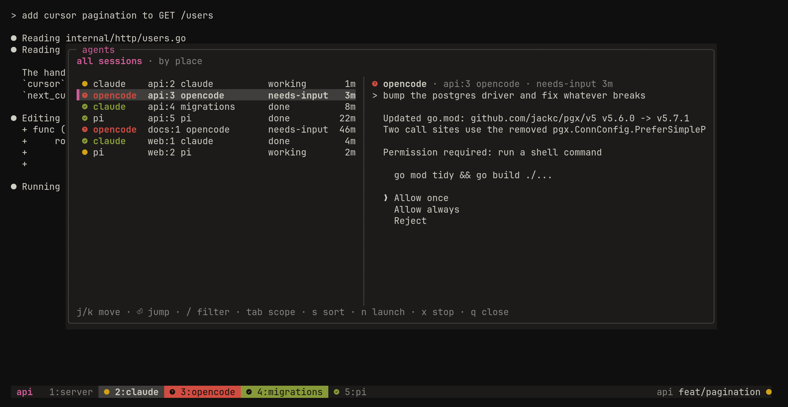
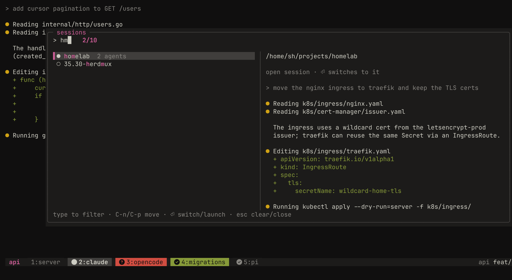
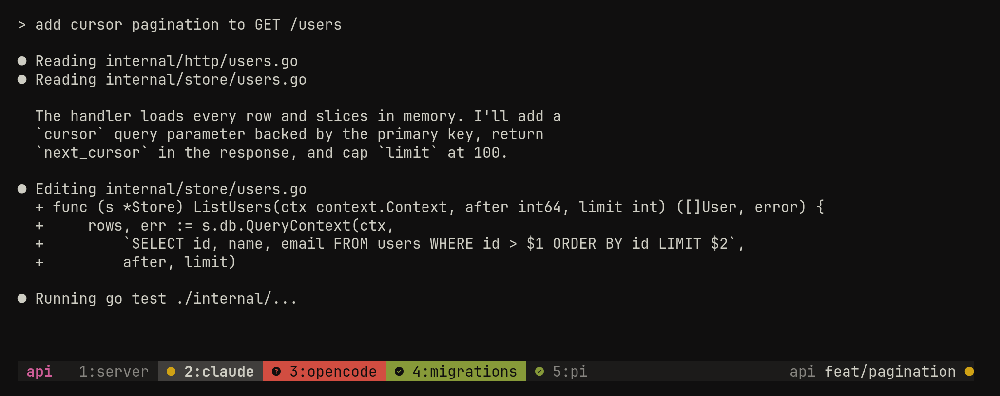

# herdmux

An AI-agent awareness layer for tmux. herdmux runs on top of your existing tmux config and shows what every coding agent (claude, opencode, pi) in every session is doing: working, waiting for you, or finished. It flags the ones that need you and gets you to them in a keypress.

herdmux is a single Go binary. It never stays running: tmux key bindings, tmux hooks and the agents' own hooks call it, and it keeps all state in tmux pane options.







## Features

**Agent state**

- Each agent pane has a state: `working`, `needs-input` (a permission prompt or a question), `done` (finished its turn) or `unknown` (an agent process recognised by name but not reporting).
- claude reports through its hooks, opencode through a plugin, pi through an extension. Agents started without those still show up as `unknown`.
- State belongs to the pane, so moving a pane moves its agent. An agent that exits, dies, or is suspended or backgrounded is dropped.

**Attention**

- When an agent moves to `needs-input` or `done` while its window isn't on screen, it gets an Attention flag. The flag stays until you look at that window. It never times out.
- When Attention is raised, herdmux rings the terminal bell once and shows a message naming the sessions, so you also hear about agents in other sessions.
- `prefix u` jumps to the next agent that needs attention, across sessions: `needs-input` before `done`, oldest first.

**Status bar**

- Window tabs show one coloured state icon per agent in the window. A tab whose agent needs attention is filled red (`needs-input`) or green (`done`).
- The left side shows the session name. The right side shows the active pane's directory, its git branch, and a `●` when the working tree has uncommitted changes. Git status refreshes when you switch panes, windows or sessions, and every 3 seconds.

**Popups** (bubbletea, drawn in the active colorscheme)

- **Agent picker** (`prefix a`): every agent with its session, window, state and age, plus a live preview of the selected pane. Filter with `/`, switch between all sessions and this session with Tab, sort by place or Attention first with `s`, launch a new agent with `n`, stop one with `x`, and jump with Enter.
- **Window organiser** (`prefix r`): reorder the session's windows (space grabs a window and j/k carry it), rename (`r`), kill (`x`), and undo moves and renames (`u`), with a live preview.
- **Launch prompt** (`prefix o`): start an agent from the menu in a new window in the current pane's directory, and switch to it.
- **Sessionizer** (`prefix g`): switch to any open session, or pick a project directory under configured roots to create or switch to its session. It opens straight into a fuzzy filter (matches highlighted, best first), with the full path and a live preview or directory listing on the right.
- In every popup, `C-n`/`C-p` move like j/k (also while typing a filter) and `C-y` acts as Enter.
- **Colorscheme picker** (no default key; bind one, or run `herdmux colorscheme`): previews each scheme live on the whole tmux UI. Enter saves it and Esc reverts.

**Colorschemes**

- One colorscheme styles all of tmux: pane backgrounds, status bar, tabs, borders, popups, menus and messages.
- 25 bundled schemes: catppuccin, flexoki, gruvbox, kanagawa, onedark, rose-pine and tokyonight variants. The default is `flexoki-dark`.
- Add your own, or override a bundled one, as TOML files in `colors/` in the config dir (`~/.config/herdmux/colors/`). Invalid schemes are listed with the reason and can't be selected.

**MCP server** (optional)

- `herdmux mcp` serves an MCP server over stdio, so an agent can read and change herdmux's setup: `read_config`, `write_config`, `list_colorschemes`, `get_colorscheme`, `set_colorscheme`, `write_colorscheme`, `delete_colorscheme` and `list_agents`. Config and scheme writes are validated before they're saved, and key changes apply live.

**CLI**

```
herdmux init                 turn the layer on (run from tmux.conf)
herdmux picker               open the agent picker popup
herdmux organiser            open the window organiser popup
herdmux next-attention       jump to the next agent that needs attention
herdmux launch [agent]       launch an agent, or open the launch prompt
herdmux sessionizer          open the session switcher / project launcher
herdmux colorscheme [name | --list]
herdmux list [--json]        list every agent: session, window, name, state, Attention
herdmux mcp                  serve the MCP server over stdio
herdmux report <working|needs-input|done|exit> --agent <name> [--pid N] [--pane %N]
herdmux install [--mcp] [--dry-run]
herdmux uninstall [--purge]
herdmux man                  show the full manual (herdmux(1))
herdmux help [--all | command]
```

`report` is the integration point: any agent can report its state by calling it.

## Supported agents

| Agent | Integration | Installed to |
|---|---|---|
| [claude](https://docs.anthropic.com/en/docs/claude-code) | hooks running `herdmux hook claude` | `~/.claude/settings.json` |
| [opencode](https://opencode.ai) | plugin | `~/.config/opencode/plugins/herdmux-agent-state.js` |
| [pi](https://github.com/badlogic/pi-mono) | extension | `~/.pi/agent/extensions/herdmux-agent-state.ts` |

The integrations do nothing unless `HERDMUX=1` is set, and only `herdmux init` sets it, inside tmux. Agents you run outside herdmux's tmux are unaffected.

## Requirements

- tmux 3.5a (the version herdmux is built and tested against)
- Linux: process checks read `/proc`. Developed on WSL2.
- Go 1.27 to build (`go.mod` pulls the exact toolchain)
- A [Nerd Font](https://www.nerdfonts.com) in your terminal, for the state icons
- A truecolor terminal

## Install

```bash
git clone <this repo> herdmux && cd herdmux
go build -o ~/.local/bin/herdmux ./cmd/herdmux   # any directory on sh's PATH
herdmux install --dry-run                        # shows every change, writes nothing
herdmux install                                  # add --mcp to register the MCP server too
tmux source-file ~/.config/tmux/tmux.conf
```

`herdmux install` appends a marked `run-shell 'herdmux init'` block to `~/.config/tmux/tmux.conf` and installs the three agent integrations. It checks everything before writing, backs up each file before its first edit, and is idempotent. `herdmux uninstall` removes exactly what install added. Remove any tmux theme plugin first, because herdmux styles the whole status bar.

See [docs/install.md](docs/install.md) for the full steps, what each step writes, and how to undo it.

## Default keys

| Key | Action |
|---|---|
| `prefix a` | agent picker |
| `prefix u` | jump to the next agent that needs attention |
| `prefix r` | window organiser |
| `prefix o` | launch an agent |
| `prefix g` | sessionizer |
| (unbound) | colorscheme picker |

A key that herdmux moves or unbinds gets its previous binding back.

## Configuration

Config lives in `$HERDMUX_CONFIG_DIR` if set, else `$XDG_CONFIG_HOME/herdmux/` if `XDG_CONFIG_HOME` is an absolute path, else `~/.config/herdmux/`:

| File | What |
|---|---|
| `config.toml` | launch menu, keys, sessionizer roots |
| `colorscheme` | the saved scheme's name (written by the picker) |
| `colors/<name>.toml` | your own colorschemes, or overrides of bundled ones |

`config.toml` (every section is optional; these are the defaults, except the roots):

```toml
[[agent]]                # the launch menu, in order; replaces the defaults if present
name = "claude"          # window name, and `herdmux launch claude`
key = "c"                # optional; picked from the name when omitted
command = "claude"       # typed into the new window's shell

[[agent]]
name = "opencode"
command = "opencode"

[[agent]]
name = "pi"
command = "pi"

[keys]                   # "prefix <key>", a root key such as "M-a", or "" to unbind
picker = "prefix a"
next-attention = "prefix u"
organiser = "prefix r"
launch = "prefix o"
sessionizer = "prefix g"
colorscheme = ""

[sessionizer]
roots = ["/home/you/projects"]   # absolute paths (~ is not expanded); none means sessions only
depth = 3                        # directory levels below each root
```

The launch menu shows only agents whose command is on `PATH`. A broken file falls back to the defaults for the broken part (a root that isn't an absolute path is left out), and the error is shown in red in the popups.

## Development

```bash
make check          # gofmt, go vet, staticcheck, govulncheck, go test, node --test (must pass before every commit)
make build          # ./herdmux
NO_WT=1 make dev    # fresh isolated `tmux -L herdmux-dev` server running the built binary; prints the attach command
tmux -L herdmux-dev kill-server
```

Tests start their own `tmux -L herdmux-test-*` servers and never touch your running tmux. Read [CONTEXT.md](CONTEXT.md) for the vocabulary and [docs/build-conventions.md](docs/build-conventions.md) for the code conventions.

## License

Licensed under the [Apache License, Version 2.0](LICENSE).
